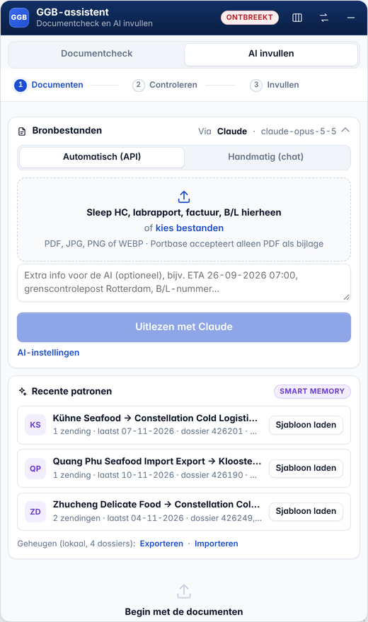
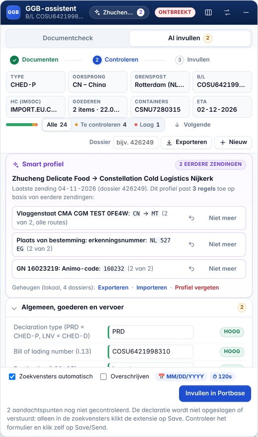
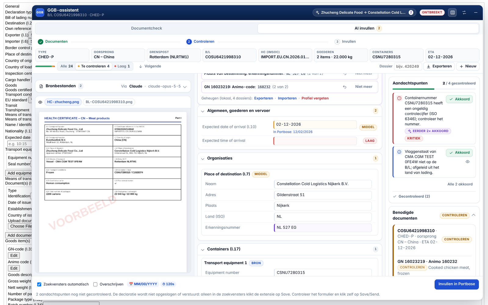

# GGB-assistent 0.7 – herontwerp

Dit document beschrijft het herontwerp van het paneel *AI invullen* in de
extensie: de nieuwe indeling (blueprint), het design system, de
functionaliteit van **Smart Memory** en hoe de code is opgebouwd.

| Compact – startscherm | Compact – voorstel | Werkruimte |
|---|---|---|
|  |  |  |

*(Voorbeeldgegevens; het HC in de viewer is een nagemaakt voorbeeld.)*

---

## 1. Layout-blueprint

Het paneel zweeft over Portbase (Shadow DOM, zodat de CSS van Portbase en van
het paneel elkaar niet raken). Er zijn twee weergaven, te wisselen met de
kolommenknop in de kop (onthouden per browser):

- **Compact** (520 px, één kolom) – naast het Portbase-formulier, voor het
  invullen zelf.
- **Werkruimte** (tot 1480 px, drie kolommen) – voor het controleren: document,
  velden en aandachtspunten naast elkaar, elke kolom scrolt apart.

```
┌──────────────────────────────────────────────────────────────────────────────────────┐
│ APP-BALK  [GGB] GGB-assistent          [✦ Zhucheng → Constellation  2] [status] ⊞ ⇆ – │
│           B/L COSU6421998310 · CHED-P                                                  │
├──────────────────────────────────────────────────────────────────────────────────────┤
│ [ Documentcheck ][ AI invullen ②]                                  (segmented tabs) │
├──────────────────────────────────────────────────────────────────────────────────────┤
│ ① Documenten ──── ② Controleren ──── ③ Invullen                         (stepper)   │
│ ┌TYPE─┐┌OORSPRONG┐┌GRENSPOST┐┌B/L┐┌HC (IMSOC)┐┌GOEDEREN┐┌CONTAINERS┐┌ETA┐   (feiten) │
│ ▬▬▬▬ [Alle 24][● Te controleren 4][● Laag 1] ↓Volgende   Dossier[426250] ⤓Exp. +Nieuw│
├───────────────────────────┬───────────────────────────────────┬──────────────────────┤
│ KOLOM 1 – BRON            │ KOLOM 2 – GGB-VELDEN              │ KOLOM 3 – AANDACHT   │
│ ▸ Bronbestanden (2)       │ ✦ Smart profiel                   │ Aandachtspunten 2/4  │
│   upload · modus · AI     │   Zhucheng → Constellation        │ ▬▬▬▬▬▬▬▬▬▬░░░░░      │
│ ┌ Documentviewer ───────┐ │   past 3 regels toe  [↶][Niet meer]│ ┌⚠ kritiek ───────┐ │
│ │ (HC.png)(BL.png) p.1  │ │ ▾ Algemeen, goederen en vervoer   │ │ tekst  [✓Akkoord]│ │
│ │                       │ │   label │ [waarde ] │ HOOG ← bron │ │ ✦ eerder 2× ak.  │ │
│ │   HC / B/L / factuur  │ │ ▾ Organisaties                    │ └──────────────────┘ │
│ │   (PDF-viewer of      │ │ ▾ Containers                      │ ✓ Gecontroleerd (2) │
│ │    afbeelding)        │ │ ▾ Documenten (I.9)                │ ▾ Benodigde documen- │
│ │                       │ │ ▾ Goederenitems                   │   ten (documentcheck)│
│ └───────────────────────┘ │   Resultaat invulronde (verslag)  │                      │
├───────────────────────────┴───────────────────────────────────┴──────────────────────┤
│ VOET  ☑ Zoekvensters automatisch ☐ Overschrijven  📅 MM/DD/YYYY ⏱120s  [Invullen ▸] │
└──────────────────────────────────────────────────────────────────────────────────────┘
```

In **compact** staan dezelfde blokken onder elkaar, in deze volgorde:
bronbestanden (na het uitlezen ingeklapt), aandachtspunten + documentcheck,
dan het profiel en de velden. De viewer is alleen in de werkruimte zichtbaar;
klikken op een bron in compact opent de werkruimte.

### Componenten

| Component | Plaats | Gedrag |
|---|---|---|
| **App-balk** | kop | Titel + dossiercontext (dossiernr, B/L, CHED-type); **profielchip** (route + aantal eerdere zendingen, klik = naar het profiel); status van de documentcheck; weergave, dock, inklappen (Alt+G). |
| **Stepper** | boven | Documenten → Controleren → Invullen; klikbaar (scrolt naar de sectie). |
| **Feiten** | boven | 8 kerngegevens in één oogopslag (4 per rij in compact, 8 in de werkruimte). |
| **Zekerheidsfilter** | boven | Mini-balk hoog/middel/laag + segmenten *Alle · Te controleren · Laag* met aantallen; **Volgende** springt naar het volgende veld met middel/laag (klapt het blok open, markeert de rij). |
| **Bronbestanden** | kolom 1 | Uploaden, modus (API/chat), extra info, *Uitlezen*. Klapt na het uitlezen in. |
| **Documentviewer** | kolom 1 | Tabs per bestand; toont PDF (op bladzijde) of afbeelding. |
| **Smart profiel** | kolom 2 | Herkende route, toegepaste regels met *terugdraaien* en *niet meer*, geheugenbeheer. |
| **Veldblokken** | kolom 2 | Accordion met animatie; per veld zekerheidsbadge = knop naar de bron; paarse rand = ingevuld door Smart Memory. |
| **Aandachtspunten** | kolom 3 | Triage: ernst (kritiek/let op/info), *Akkoord* per punt, teller + voortgangsbalk, *Alle akkoord*, *Gecontroleerd*-lijst met *ongedaan* en *altijd bij deze route*. Schone staat als alles akkoord is. |
| **Documentcheck** | kolom 3 | Vereiste documenten volgens TARIC + NVWA-regels. |
| **Invulbalk** | voet | Opties, voortgang, *Stop*, *Invullen in Portbase*; meldt hoeveel aandachtspunten nog open staan. |
| **Toasts** | onder | Bevestiging bij kopiëren, exporteren, akkoord, Smart Memory. |

### Gekoppelde documentviewer

- De viewer is een extensiepagina (`extension/viewer.html`) in een iframe. Zo
  werkt de PDF-viewer van de browser zonder de beveiligingsregels (CSP) van
  Portbase. Het paneel stuurt het bestand met `postMessage`; de viewer
  accepteert alleen berichten van de Portbase-pagina. Niets gaat naar een server.
- Elke waarde heeft een **bron** van de AI, bijv. `HC vak I.12 p.1` of `B/L p.1`.
  De AI-instructies vragen nu expliciet om de bladzijde. Het paneel kiest het
  document op soort (HC, labrapport, vangstcertificaat via de documentenlijst;
  B/L, factuur, paklijst op bestandsnaam) en opent het op die bladzijde
  (`#page=N`).
- In de werkruimte volgt de viewer de **focus**: klik in een veld en het
  bijbehorende document staat ernaast. In beide weergaven opent een klik op een
  zekerheidsbadge, een bestandsnaam of het oog bij een aandachtspunt het document.
- Grens: de AI levert document + vak + bladzijde, geen coördinaten. Springen
  naar de juiste *regel* binnen een bladzijde kan dus niet; het vaknummer staat
  wel in de bron (tooltip) zodat je weet waar je moet kijken.

### Micro-interacties

- Accordions klappen soepel open en dicht (`::details-content` met
  `interpolate-size`), pijltjes draaien mee.
- Een afgevinkt aandachtspunt schuift weg en de teller springt op; nieuwe items
  en bestanden komen binnen met een korte fade.
- De viewer licht kort op als hij naar een ander document springt.
- Een skeleton tijdens het uitlezen.
- Bij `prefers-reduced-motion` staan alle animaties uit.

---

## 2. Design system

Alle waarden staan als CSS-variabelen op `.wrap` in `extension/content.js`.

| Token | Waarde | Gebruik |
|---|---|---|
| `--navy` / `--navy-2` | `#0a1f44` / `#123066` | app-balk, toasts |
| `--pb` / `--pb-d` / `--pb-z` | `#1f4fd1` / `#1a42b0` / `#eef3ff` | primaire actie, focus, info |
| `--ok` · `--let` · `--fout` | `#0f7b4f` · `#a35a00` · `#c0262d` (+ `-z` vlak, `-r` rand) | status: success, warning, danger |
| `--mem` | `#6d3fd6` (+ `#f3eefe`) | alles van Smart Memory |
| `--inkt` · `--zacht` · `--lijn` · `--vlak` | `#0f172a` · `#64748b` · `#e2e8f0` · `#f8fafc` | tekst, secundaire tekst, randen, achtergrond |
| `--r1/2/3` | 6 / 8 / 12 px | invoer, knoppen/badges, kaarten |
| `--sh1` / `--sh2` / `--sh-paneel` | fijne, gelaagde schaduwen | kaarten, hover, paneel |
| Lettertype | Inter → Segoe UI Variable → system-ui, 13 px, tabulaire cijfers | |

Iconen zijn inline SVG's (lijn 1,8 px, `currentColor`).

**Waarom geen Tailwind of React?** De extensie heeft geen build-stap voor het
paneel. Manifest V3 staat geen scripts van een CDN toe (de Tailwind Play CDN is
een script), en het paneel leeft in een Shadow DOM, waar een globale
Tailwind-stylesheet niet doorheen komt. Het design system is daarom
geïmplementeerd als tokens + componentklassen in dezelfde stijl. Een overstap
naar React/Tailwind kan later met een bundler (zoals voor `ai.bundle.js`), maar
levert nu vooral risico op voor de invullogica.

---

## 3. Smart Memory – functionaliteitsspecificatie

Code: `js/geheugen.js` (pure logica, getest in `test/geheugen.test.js`).
Opslag: `chrome.storage.local`, sleutel `ggb.geheugen`. Alles blijft op de pc
van de gebruiker; er is geen backend.

### 3.1 Profiel

Een profiel is een vaste route: **exporteur → ontvanger**. De ontvanger is de
plaats van bestemming (I.12), en anders de importeur. De sleutel is genormaliseerd: kleine letters,
zonder accenten, leestekens en rechtsvorm (`Co., Ltd`, `B.V.`, `GmbH`…):

```
zhucheng delicate food > constellation cold logistics nijkerk
```

De sleutel komt uit het **AI-voorstel zoals de AI het gaf**, niet uit de
gecorrigeerde versie. De volgende keer levert de AI immers dezelfde ruwe
namen, en daarop moet het profiel gevonden worden.

### 3.2 Leermoment

Bij **Invullen in Portbase** wordt het dossier opgeslagen. Dat is het moment
waarop de gebruiker het voorstel goedkeurt. Opnieuw invullen van hetzelfde
voorstel vervangt het eerdere dossier, zodat niets dubbel telt. Per dossier:

- `obs`: per leerbaar veld `{ai, finaal}`: wat de AI gaf en wat de gebruiker
  uiteindelijk gebruikte;
- `waarschuwingen`: per soort aandachtspunt of het akkoord was;
- `sjabloon`: de vaste gegevens (zie 3.5);
- dossiernummer, B/L, HC-nummer, GN-codes, tijd.

Maximaal 150 dossiers (oudste eerst weg).

### 3.3 Leerbare velden

| Soort | Sleutel | Voorbeeld |
|---|---|---|
| Algemeen | veldnaam | grenspost, transportconditie, gecertificeerd voor, land van lading |
| Organisaties | `plaatsBestemming.erkenningsnummer` | OAI/erkenningsnummer van de coldstore (`NL 527 EG`) |
| Vlaggenstaat | `vlag\|<schip>` – **over alle routes** | `CMA CGM TEST 0FE4W` → `MT` |
| Goederen | `goed:<GN van de AI>.<veld>` | Animo-code, verpakking, erkenningsnummer, aard; ook een gecorrigeerde GN-code |
| Documenten | `doc:<type>.<veld>` | Portbase-type, opnemen in GGB |

Zendinggebonden gegevens (B/L, datums, gewichten, colli, containers, batches)
worden niet geleerd.

### 3.4 Regels toepassen

Bij een nieuw AI-voorstel voor een bekend profiel neemt het geheugen een
waarde `v` over als:

1. `v` in **minstens 2** dossiers van dit profiel de eindwaarde was
   (`MIN_BEVESTIGD`);
2. `v` in **minstens 75 %** van de dossiers met dit veld de eindwaarde was
   (`MIN_AANDEEL`); bij wisselend gebruik dus geen regel;
3. de AI het **minstens één keer anders** had. Klopt de AI altijd, dan voegt
   het geheugen niets toe;
4. de AI nu iets anders voorstelt dan `v`;
5. de gebruiker de regel niet heeft uitgezet (*Niet meer*).

Toegepaste waarden krijgen een paarse rand. Het Smart profiel toont ze als
*"Dit profiel past 3 regels toe op basis van eerdere zendingen"*, met per
regel `van → naar (2 van 2)` en de knoppen **terugdraaien** (AI-waarde terug)
en **Niet meer** (terugdraaien en de regel voor dit profiel uitzetten). Laat de
gebruiker een toegepaste waarde staan, dan telt dat bij het volgende
leermoment als bevestiging. Draait de gebruiker hem terug, dan daalt het
aandeel en verdwijnt de regel vanzelf.

### 3.5 Aandachtspunten

- Gelijksoortige meldingen worden herkend aan hun tekst, met getallen en
  aanhalingen weggelaten (*"Som van de colli (40) wijkt af … (44)"* is
  dezelfde soort als *"… (2000) wijkt af … (2100)"*).
- Ernst: **kritiek** (ongeldig containernummer, netto > bruto, geen HC,
  ontbreekt, som brutogewicht ≠ totaal, ongeldig brutogewicht uit een document), **let op**, of **info** (berekend, afgeleid, standaard).
- Was een soort bij dit profiel minstens 2× en in minstens 75 % van de
  gevallen akkoord, dan staat hij **voorgevinkt** met een paarse badge
  *"eerder 3× akkoord"*. Kritieke punten worden **nooit** vanzelf
  voorgevinkt; ze tonen alleen *"eerder 2× akkoord"* als hint.
- Per punt kan de gebruiker expliciet **"Altijd bij deze route"** kiezen. Dan
  wordt het punt ook als het kritiek is voorgevinkt, maar altijd zichtbaar in
  de lijst *Gecontroleerd* en terug te draaien.

### 3.6 Recente patronen en sjablonen

Het startscherm toont de laatste 6 routes: exporteur → ontvanger, aantal
zendingen, laatste datum, dossiernummers en GN-codes. **Sjabloon laden**
maakt een voorstel van de laatste zending van die route met alleen de vaste
gegevens: organisaties met adres en erkenningsnummer, declaratietype,
grenspost, landen, I.18, transportconditie, vervoermiddel en de producten (GN,
Animo, verpakking, aard). B/L, gewichten, containers en documenten blijven leeg.
Daarna vul je aan of upload je de documenten alsnog voor een AI-voorstel.

### 3.7 Delen en beheer

- **Exporteren / Importeren**: het geheugen als JSON. Importeren voegt samen
  (dossiers op id, regels per profiel), zodat collega's elkaars ervaring kunnen
  overnemen zonder backend.
- **Profiel vergeten**: verwijdert alle dossiers en regels van een route.
- Privacy: alleen de velden uit het voorstel; geen documenten, geen
  API-sleutels.

### 3.8 Doorkijk: gedeeld geheugen via een backend

Het formaat is daarop voorbereid (dossiers met id, tijd en profiel; regels
apart):

- `POST /geheugen/dossiers` bij elk leermoment, `GET /geheugen?profiel=…` bij
  herkenning;
- de drempels (`MIN_BEVESTIGD`, `MIN_AANDEEL`) blijven aan de clientkant, zodat
  het gedrag gelijk blijft;
- regels die een teamleider vaststelt (bijv. "Constellation Nijkerk = NL 527 EG")
  krijgen een eigen bron en wegen zwaarder dan geleerde regels.

---

## 4. Code

| Bestand | Wat |
|---|---|
| `extension/content.js` | Paneel: design system (CSS), app-balk, weergaven, viewer-koppeling, triage, zekerheidsfilter, Smart profiel, recente patronen, toasts. |
| `js/geheugen.js` | Smart Memory: profielen, leren, toepassen, aandachtspunten, sjablonen, samenvoegen. |
| `extension/viewer.html/.js/.css` | Documentviewer (extensiepagina, `web_accessible_resources`). |
| `js/ggb-ai.js` | AI-instructies: bron met bladzijde. |
| `test/geheugen.test.js` | Unittests Smart Memory. |
| `test/e2e-extensie.mjs` | E2E: triage tot een schone staat, werkruimte + viewer, route herkend bij de tweede zending, recente patronen. |
